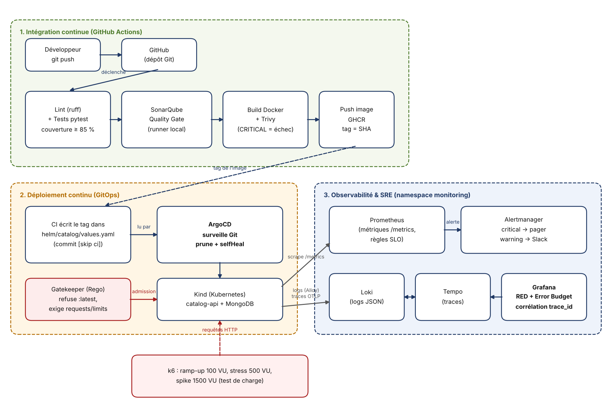
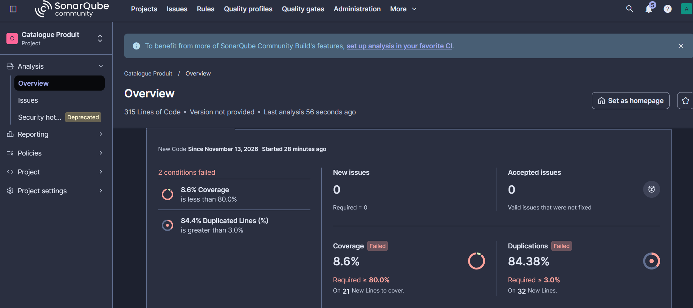
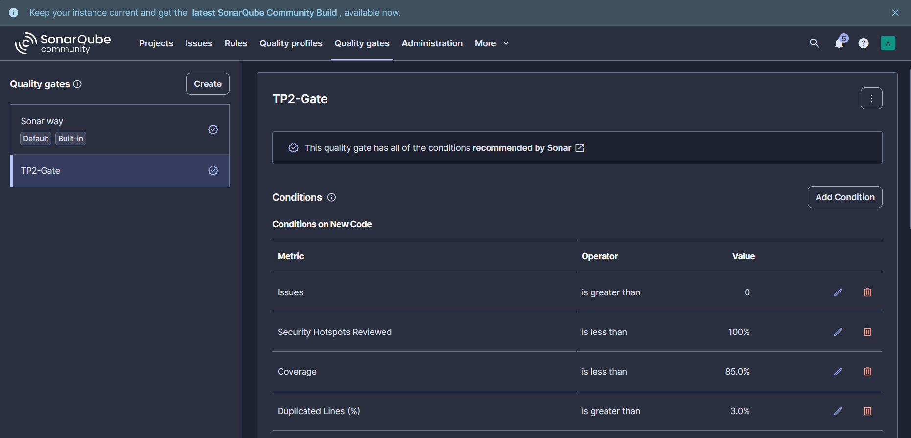
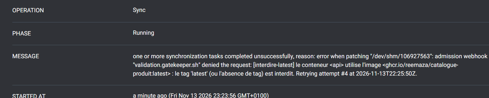
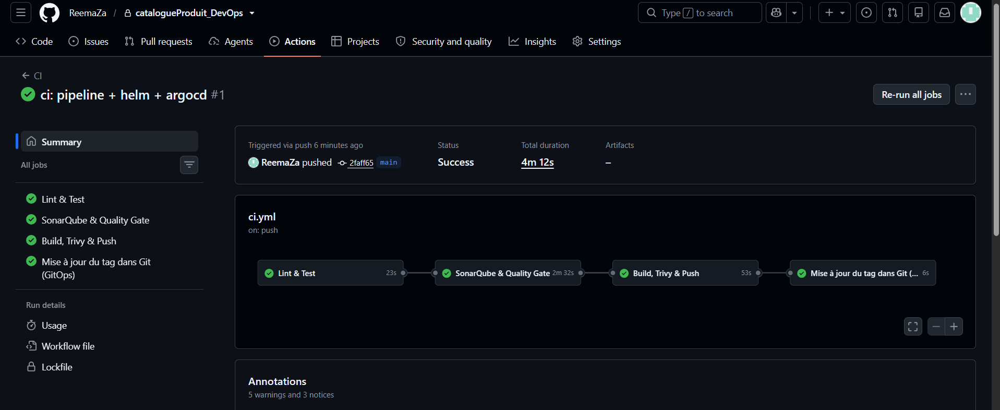
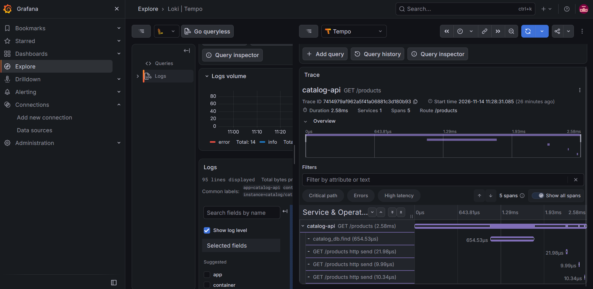
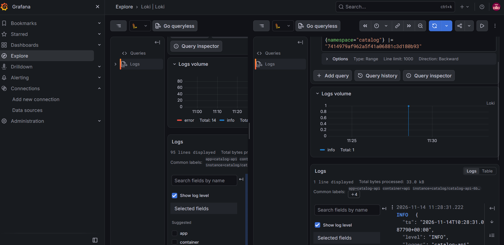
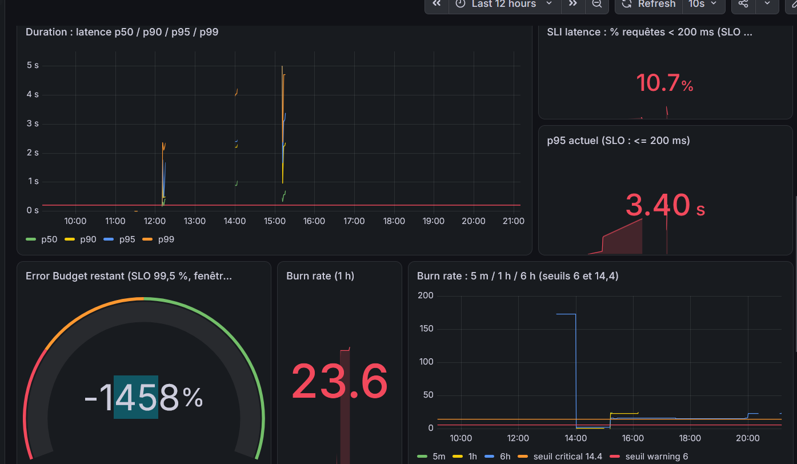

# Rapport SRE — Catalogue Produit (TP2 DevOps avancé)

> Les chiffres sont relevés sur les captures de `rapport/screenshots/` (numéro de capture entre parenthèses) ou calculés à partir d'elles.

## 1. Architecture

Push GitHub → CI (lint + tests ≥ 85 % → SonarQube → build Docker → Trivy → push GHCR) → la CI écrit le tag dans `helm/catalog/values.yaml` → ArgoCD déploie sur Kind, sous contrôle de Gatekeeper. L'API est observée par Prometheus, Loki, Tempo et Grafana.

## 2. Quality & security gates
- **Tests** : 43 tests pytest, couverture **93,93 %** (seuil 85 %), rapport Cobertura `coverage.xml`.
- **SonarQube** : après introduction volontaire de code dupliqué, la Quality Gate est **en échec** : couverture du nouveau code 8,6 %, duplication 84,38 % (capture 02).
  
    > ** sur le seuil de couverture.** La capture 02 a été prise avec un seuil de couverture de **80 %** (conditions recommandées par SonarQube, qui pré-remplissent la gate `TP2-Gate` : le script `scripts/sonar-setup.sh` n'a pas pu les remplacer). Nous avons ensuite **corrigé manuellement** la condition à **85 %** dans l'interface (capture 34). **La capture d'échec n'a pas été refaite** : elle date d'avant la correction. Hotspots revus (< 100 %) et duplication (> 3 %) étaient déjà conformes ; la gate contient aussi « Issues > 0 ».
  
- **Gatekeeper** : un commit avec `tag: latest` a été poussé ; ArgoCD a tenté la synchronisation et l'API Server l'a **rejetée** (`admission webhook "validation.gatekeeper.sh" denied the request: [interdire-latest]…`) (captures 11-12). L'ancienne version a continué de tourner.
  
- **CI/CD** : pipeline complète verte en 4 min 12 s (capture 06), déploiement ArgoCD Synced/Healthy (capture 13).
  

## 3. Observabilité
Prometheus scrape le pod annoté : cible `catalog-api` **UP** (capture 16). La corrélation par `trace_id` fonctionne dans les deux sens : du log à la trace `7414979af962a5f41a06881c3d180b93` (capture 18), puis de la trace au log, où Loki retrouve exactement 1 ligne (capture 20).

## 4. SLI / SLO
| SLO | Cible | SLI |
|---|---|---|
| Disponibilité | 99,5 % (statut < 500) sur 30 j glissants | 1 − erreurs 5xx / requêtes (hors `/health`, `/ready`) |
| Latence | p95 ≤ 200 ms | `histogram_quantile(0.95, …)` |

**Error budget** = 0,5 %. **Burn rate** = taux d'erreur / 0,005. Alerte **Critical** : 2 % du budget en 1 h ⇒ 0,02 × 720 / 1 = **14,4** (fenêtres 1 h et 5 min, seuil 7,2 %). Alerte **Warning** : 5 % en 6 h ⇒ 0,05 × 720 / 6 = **6** (fenêtres 6 h et 30 min, seuil 3 %). Règles : `k8s/observability/slo-rules.yaml`.

## 5. Analyse de l'incident simulé

### 5.1 Scénario
Test k6 (`loadtest/k6/catalog.js`) avec `FLAKY_SHARE=0.4` : 40 % du trafic sur `/flaky` (échoue 30 % du temps) ⇒ taux d'erreur attendu 0,4 × 0,3 = **12 %**. Ramp-up 100 VU, stress 500 VU, spike 1 500 VU. Début ≈ **15:10**, durée **7 min 25 s**.

### 5.2 Résultats k6 (capture 31)
- **15 560** requêtes, 34,9 req/s en moyenne, **1 500** VU max.
- Échecs : **52,94 %** (seuil 0,5 % ❌) · p95 : **49,22 s** (seuil 200 ms ❌).

### 5.3 Impact sur le dashboard (captures 30 et 35)

- **Rate** : 10,8 req/s au moment de la capture 30 ; pic ≈ 18 req/s sur `/products/{product_id}`.
- **Errors** : **12,3 %** d'erreurs (attendu 12 %), pic 5xx ≈ 6 req/s, tout sur `/flaky`.
- **Duration** : percentiles jusqu'à ≈ 5 s (p99), p95 = **3,40 s**, 10,7 % des requêtes sous 200 ms ⇒ SLO de latence violé.
- **Error budget** : jauge à **−1 458 %** ⇒ SLO violé (r = 15,58 × 0,005 = 7,79 % d'erreurs sur l'historique). Burn rate 1 h = **23,6**, au-dessus du seuil 14,4 à partir de ≈ 15:15.
- La capture 35 est relevée **après** redémarrage du cluster (historique Prometheus conservé), pas en direct.

### 5.4 Calcul manuel du burn rate
| Source | Taux d'erreur | Burn rate = taux / 0,005 |
|---|---|---|
| Code : 0,4 × 0,3 | 12 % | **24** |
| Dashboard (capture 30) | 12,3 % | **24,6** |
| Alerte reçue, « Taux d'erreur 1h » (capture 29) | 11,48 % | **22,96** |
| Panneau Burn rate 1 h (capture 35) | 11,8 % | **23,6** |

Toutes les valeurs (22,96 à 24,6) dépassent 14,4 : condition critique remplie (11,48 % > 7,2 %). Avec 22,96 : budget brûlé en 1 h = 22,96 / 720 = **3,19 %** (> 2 % ⇒ page), budget épuisé en 720 / 22,96 ≈ **31,4 h**.

### 5.5 Alerte (captures 28 et 29)
Les alertes passent à PENDING puis **FIRING**. `CatalogErrorBudgetBurnCritical` est FIRING à **15:13:43** (Alertmanager : `14:13:43Z`), soit ≈ 3 min après le début du test, et routée vers `pager`. L'alerte Warning, aussi FIRING, est inhibée dans Alertmanager par la règle d'inhibition.

### 5.6 Cause et actions
- **Cause** : `/flaky` très sollicité (40 % du trafic), aggravé par la saturation de l'API (1 réplique, 250 m CPU).
- **Détection** : alerte en ≈ 3 min, très en avance sur l'épuisement du budget (≈ 31 h).
- **Actions** : retry avec backoff, circuit breaker, HPA, SLO par endpoint, `requests/limits` plus élevés.

## 6. Limites
- Fenêtre « 30 j » : le Prometheus du TP n'a que quelques heures d'historique ; la jauge inclut aussi une activité antérieure aux deux tests (vers 12:10).
- Le SLI est mesuré côté serveur : au Run A, le dashboard (début du test) indiquait 0,202 % d'erreurs alors que k6 mesurait 55,64 % d'échecs sur tout le test (capture 25), surtout des requêtes expirées côté client. Il faudrait aussi mesurer à l'entrée du cluster.
- Slack/pager factices ; 1 réplique ; Mongo sans volume persistant.