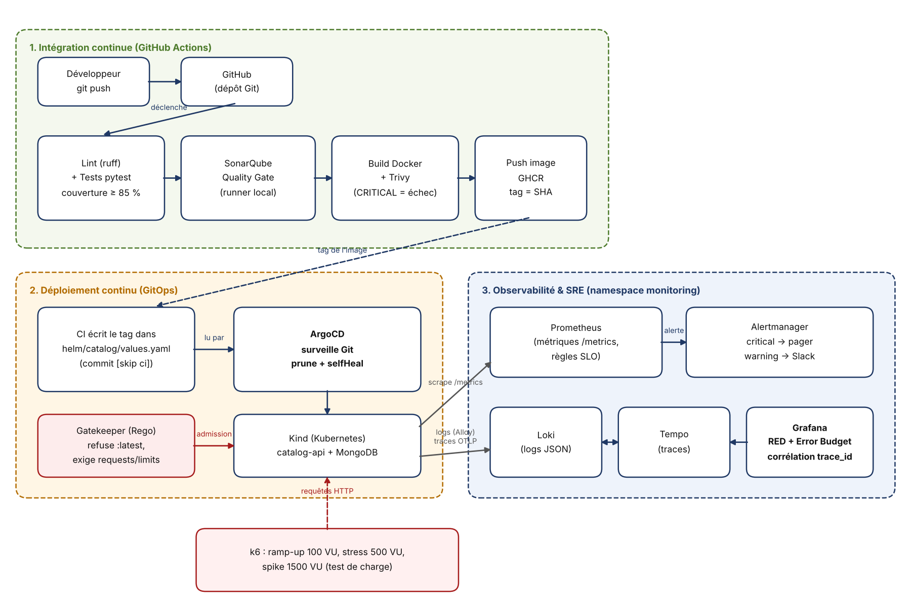
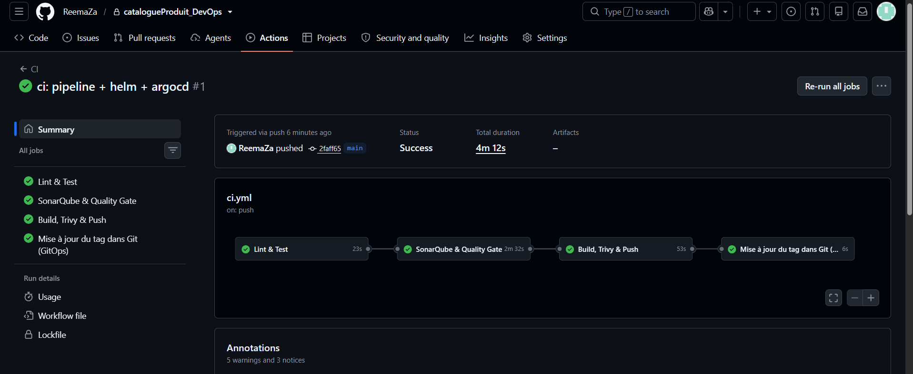
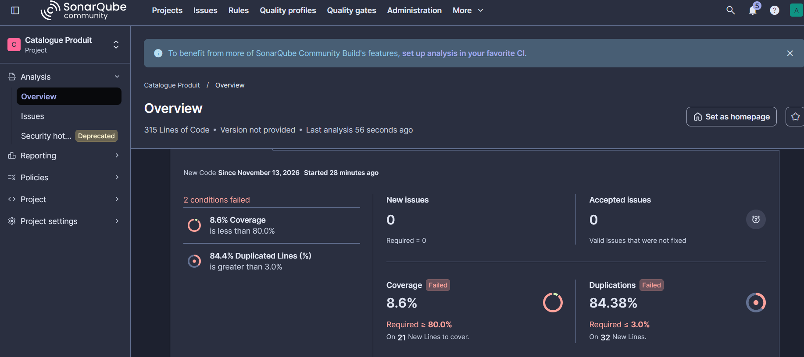
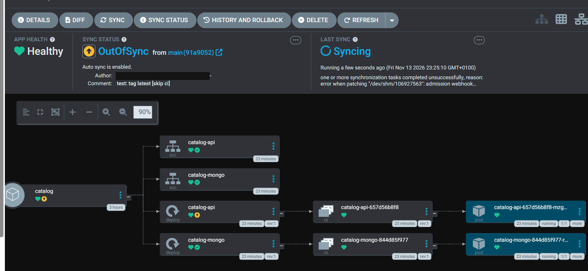
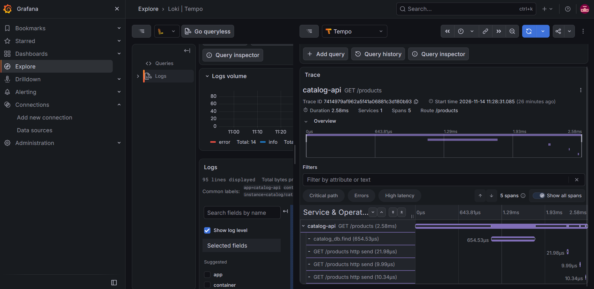

# Catalogue Produit — Continuous Delivery, Quality Gates & SRE

TP2 de **DevOps avancé** : une API REST de catalogue de produits (FastAPI + MongoDB) livrée par une chaîne **CI/CD sécurisée**, déployée en **GitOps** sur Kubernetes, **observée** de bout en bout (OpenTelemetry, Prometheus, Loki, Tempo, Grafana) et pilotée par des objectifs **SRE** (SLI/SLO, error budget, alertes sur le burn rate) validés par un test de charge k6.




## Sommaire
1. [Ce que fait le projet](#1-ce-que-fait-le-projet)
2. [Stack technique](#2-stack-technique)
3. [Structure du dépôt](#3-structure-du-dépôt)
4. [L'API](#4-lapi)
5. [Démarrage rapide](#5-démarrage-rapide)
6. [Pipeline CI/CD et GitOps](#6-pipeline-cicd-et-gitops)
7. [Barrières de qualité et de sécurité](#7-barrières-de-qualité-et-de-sécurité)
8. [Observabilité](#8-observabilité)
9. [SRE : SLO, error budget, alertes, k6](#9-sre--slo-error-budget-alertes-k6)
10. [Résultats](#10-résultats)
11. [Correspondance avec le barème](#11-correspondance-avec-le-barème)

## 1. Ce que fait le projet
- Une **API de catalogue** (CRUD produits, filtres, statistiques) avec des endpoints techniques exigés par le sujet : `/metrics` (format Prometheus), `/checkout` (lent) et `/flaky` (erreurs intermittentes).
- Des **tests automatiques** .
- Une **CI GitHub Actions** : Lint + tests → SonarQube + Quality Gate → build Docker → scan Trivy (CRITICAL = échec) → push GHCR → mise à jour automatique du tag dans Git.
- Un **déploiement continu GitOps** avec ArgoCD (Helm), protégé par **OPA Gatekeeper** (refuse `:latest`, exige `requests/limits`, exige le label `owner`).
- Une **plateforme d'observabilité** avec corrélation logs ↔ traces par `trace_id`.
- Une **démarche SRE** : SLO de disponibilité 99,5 % et de latence p95 ≤ 200 ms, jauge d'error budget, alertes multi-window multi-burn-rate (14,4 et 6), test de charge k6 à 3 scénarios.

## 2. Stack technique
| Domaine | Outils |
|---|---|
| Microservice & tests | Python 3.12, FastAPI, MongoDB 7 (`motor`), pytest, pytest-cov, mongomock-motor, ruff |
| Qualité & sécurité | SonarQube Community (Docker), Trivy |
| Policy enforcement | OPA Gatekeeper (ConstraintTemplates en Rego) |
| Orchestration & CI/CD | Kubernetes (Kind), GitHub Actions (runner auto-hébergé), Helm, ArgoCD, GHCR |
| Observabilité | OpenTelemetry, Prometheus, Alertmanager, Grafana, Loki, Tempo, Grafana Alloy |
| SRE & charge | k6, règles Prometheus (recording + alerting) |

## 3. Structure du dépôt
```text
.
├── app/                         # Code de l'API FastAPI
│   ├── main.py                  #   point d'entrée, middleware de métriques, /metrics
│   ├── database.py              #   connexion MongoDB (motor)
│   ├── models.py                #   modèles Pydantic
│   ├── metrics.py               #   compteurs et histogramme Prometheus (RED)
│   ├── telemetry.py             #   OpenTelemetry : traces, métriques, logs JSON avec trace_id
│   ├── utils.py                 #   utilitaires (validation d'ObjectId)
│   └── routers/
│       ├── products.py          #   CRUD, filtres, /products/stats, /products/low-stock
│       └── ops.py               #   /health, /ready, /checkout (lent), /flaky (erreurs)
├── tests/                       # 43 tests pytest (nominal + cas limites), couverture 93,9 %
├── Dockerfile                   # image multi-stage, utilisateur non-root
├── docker-compose.yml           # MongoDB local de développement
├── docker-compose.sonar.yml     # SonarQube + PostgreSQL
├── sonar-project.properties     # configuration de l'analyse SonarQube
├── pytest.ini · .coveragerc · ruff.toml · requirements*.txt
├── .github/workflows/ci.yml     # pipeline CI/CD
├── helm/catalog/                # chart Helm (API + MongoDB), values.yaml (tag mis à jour par la CI)
├── argocd/application.yaml      # Application ArgoCD (prune + selfHeal)
├── k8s/
│   ├── kind-config.yaml         #   cluster Kind
│   ├── namespace.yaml
│   ├── gatekeeper/
│   │   ├── templates/           #   ConstraintTemplates (Rego) : no-latest-tag, require-resources, require-labels
│   │   └── constraints/         #   Contraintes : interdire-latest, exiger-resources, exiger-label-owner
│   ├── samples/                 #   manifestes conformes / non conformes pour tester Gatekeeper
│   └── observability/           #   kps / loki / tempo / alloy values, slo-rules.yaml, dashboard-sre.yaml
├── loadtest/k6/catalog.js       # test de charge : ramp-up 100 / stress 500 / spike 1500 VU
├── scripts/
│   ├── sonar-setup.sh           #   crée la Quality Gate et le token SonarQube
│   └── install-observability.sh #   installe Loki, Tempo, Prometheus/Grafana/Alertmanager, Alloy
├── tools/gen_dashboard.py       # génère le dashboard Grafana (dashboard-sre.yaml)
├── rapport/
│   ├── architecture.png         #   schéma d'architecture
│   └── screenshots/             #   captures d'écran du TP (01 → 31)
├── RAPPORT-SRE.md               # rapport SRE (analyse de l'incident simulé)
└── README.md
```

## 4. L'API
| Méthode | Route | Rôle |
|---|---|---|
| `POST` | `/products` | créer un produit (prix en centimes) |
| `GET` | `/products` | lister (filtres, pagination) |
| `GET` | `/products/stats` · `/products/low-stock` | statistiques (`$facet`) · produits à faible stock |
| `GET` `PATCH` `DELETE` | `/products/{id}` | lire, modifier, supprimer |
| `POST` | `/checkout` | commande, latence simulée 100 à 600 ms, décrément de stock atomique |
| `GET` | `/flaky` | renvoie HTTP 500 avec la probabilité `FLAKY_ERROR_RATE` (30 % par défaut) |
| `GET` | `/health` · `/ready` | sondes de vie et de disponibilité (base comprise) |
| `GET` | `/metrics` | métriques au format Prometheus |

- `MONGO_URL`, `MONGO_DB`, `FLAKY_ERROR_RATE` : listées dans `.env.example` (valeurs par défaut utilisables en local).
- `OTEL_SERVICE_NAME`, `OTEL_EXPORTER_OTLP_ENDPOINT`, `OTEL_EXPORTER_OTLP_METRICS_ENDPOINT` : lues par `app/telemetry.py`, **facultatives** (sans endpoint, l'export OpenTelemetry est simplement désactivé, ce qui est le cas en local et dans les tests). Sur Kubernetes, elles sont injectées par `helm/catalog/templates/deployment.yaml`.
- `LOG_LEVEL` : niveau des logs, `INFO` par défaut.

## 5. Démarrage rapide
Prérequis : Docker, Python 3.12+, `kubectl`, `kind`, `helm`, `k6`. Tout a été réalisé sous WSL2 (Ubuntu).

**a) En local (API + tests)**
```bash
docker compose up -d                       # MongoDB
python3 -m venv .venv && source .venv/bin/activate
pip install -r requirements-dev.txt
ruff check . && pytest                     # échoue sous 85 % de couverture
uvicorn app.main:app --reload              # http://localhost:8000/docs
```

**b) Cluster Kubernetes + règles Gatekeeper**
```bash
kind create cluster --name catalog --config k8s/kind-config.yaml
kubectl apply -f k8s/namespace.yaml
helm repo add gatekeeper https://open-policy-agent.github.io/gatekeeper/charts
helm install gatekeeper gatekeeper/gatekeeper -n gatekeeper-system --create-namespace
kubectl apply -f k8s/gatekeeper/templates/ && sleep 10 && kubectl apply -f k8s/gatekeeper/constraints/
kubectl apply -f k8s/samples/good-pod.yaml      # accepté
kubectl apply -f k8s/samples/bad-latest.yaml    # refusé : [interdire-latest]
kubectl apply -f k8s/samples/bad-no-resources.yaml  # refusé : [exiger-resources]
```

**c) Déploiement GitOps (ArgoCD)**
```bash
kubectl create namespace argocd
kubectl apply -n argocd --server-side --force-conflicts -f https://raw.githubusercontent.com/argoproj/argo-cd/stable/manifests/install.yaml
kubectl apply -f argocd/application.yaml        # ArgoCD déploie helm/catalog
```
L'API est alors disponible sur http://localhost:8080 (NodePort 30080 mappé par Kind).

**d) Observabilité puis test de charge**
```bash
bash scripts/install-observability.sh           # Loki, Tempo, Prometheus, Grafana, Alertmanager, Alloy
kubectl apply -f k8s/observability/slo-rules.yaml -f k8s/observability/dashboard-sre.yaml
ulimit -n 65535
k6 run loadtest/k6/catalog.js                              # trafic de référence (1 % de /flaky)
k6 run -e FLAKY_SHARE=0.4 loadtest/k6/catalog.js           # incident simulé (40 % de /flaky)
```
Grafana : http://localhost:9090 (admin / admin). Prometheus : `kubectl -n monitoring port-forward svc/kube-prometheus-stack-prometheus 9091:9090`. Alertmanager : `kubectl -n monitoring port-forward svc/kube-prometheus-stack-alertmanager 9093:9093`.

## 6. Pipeline CI/CD et GitOps
`.github/workflows/ci.yml`, déclenché à chaque `push` :

1. **Lint & Test** : `ruff`, puis `pytest` (échec sous 85 % de couverture).
2. **SonarQube & Quality Gate** : analyse sur un *runner auto-hébergé* (SonarQube est local), pipeline bloquée si la gate échoue.
3. **Build, Trivy & Push** : image Docker taguée avec le SHA court du commit, scan Trivy (**CRITICAL = échec**), push sur GHCR.
4. **Mise à jour du tag (GitOps)** : la CI écrit le tag dans `helm/catalog/values.yaml` (commit `[skip ci]`) ; **ArgoCD** détecte le changement et synchronise le cluster.

Les secrets (`SONAR_TOKEN`, `SONAR_HOST_URL`) sont dans **GitHub Secrets** ; le push d'image utilise le `GITHUB_TOKEN` avec les permissions minimales.



## 7. Barrières de qualité et de sécurité
- **SonarQube** : la pipeline est bloquée si la couverture du nouveau code est insuffisante, si un *Security Hotspot* n'est pas revu ou si la duplication dépasse 3 % (`scripts/sonar-setup.sh`).
- **Trivy** : toute vulnérabilité CRITICAL fait échouer la pipeline.
- **OPA Gatekeeper** (Rego, rejet à l'API Server) : `K8sNoLatestTag` (interdit `:latest` et l'absence de tag), `K8sRequireResources` (`requests` et `limits` CPU/mémoire obligatoires), `K8sRequiredLabels` (label `owner` obligatoire).




## 8. Observabilité
- **Traces + logs JSON + métriques** via OpenTelemetry (`app/telemetry.py`) ; chaque log porte le `trace_id` de sa requête.
- **Prometheus** découvre les pods annotés `prometheus.io/scrape: "true"` ; **Loki** reçoit les logs (via Alloy) ; **Tempo** reçoit les traces (OTLP).
- **Corrélation** dans Grafana : log → trace (*derived field*) et trace → logs (*tracesToLogs*).



## 9. SRE : SLO, error budget, alertes, k6
| SLO | Cible |
|---|---|
| Disponibilité | 99,5 % de requêtes avec statut < 500 (fenêtre glissante 30 j) |
| Latence | p95 ≤ 200 ms |

- **Error budget** = 0,5 % ; **burn rate** = taux d'erreur / 0,005.
- **Alerte Critical (page)** : 2 % du budget en 1 h ⇒ burn rate **14,4** (fenêtres 1 h et 5 min).
- **Alerte Warning (Slack)** : 5 % du budget en 6 h ⇒ burn rate **6** (fenêtres 6 h et 30 min).
- Règles : `k8s/observability/slo-rules.yaml` ; dashboard RED + jauge Error Budget : `k8s/observability/dashboard-sre.yaml`.
- **k6** (`loadtest/k6/catalog.js`) : ramp-up 0 → 100 VU, stress à 500 VU, spike à 1 500 VU pendant 30 s ; la part de `/flaky` se règle par `FLAKY_SHARE`.

## 10. Résultats
Incident simulé (`FLAKY_SHARE=0.4`, 14 novembre 2026) :

| Mesure | Valeur |
|---|---|
| Durée du test | 7 min 25 s |
| Requêtes (k6) | 15 560 · 34,9 req/s en moyenne · 1 500 VU max |
| Taux d'erreur côté serveur (dashboard) | 12,3 % (attendu : 0,4 × 0,3 = 12 %) |
| Taux d'erreur 1 h porté par l'alerte | 11,48 % ⇒ burn rate ≈ 23 (> 14,4) |
| Alerte critique | FIRING à 15:13:43, ≈ 3 min après le début du test, routée vers `pager` |
| Seuils k6 | tous en échec (p95 = 49,22 s ; 52,94 % de requêtes en échec, timeouts compris) |


## 11. Correspondance avec le barème
| Critère (pondération) | Où le trouver |
|---|---|
| Code & tests unitaires (15 %) | `app/`, `tests/`, `coverage.xml` (93,9 %) |
| Quality & Security gates (20 %) | `sonar-project.properties`, `scripts/sonar-setup.sh`, `k8s/gatekeeper/`, captures 02, 11, 12 |
| Pipeline CI/CD & GitOps (20 %) | `.github/workflows/ci.yml`, `helm/`, `argocd/`, captures 05, 06, 13 |
| Observabilité (20 %) | `app/telemetry.py`, `k8s/observability/`, captures 16 à 21 |
| Ingénierie SRE & charge (25 %) | `slo-rules.yaml`, `loadtest/k6/catalog.js`, `dashboard-sre.yaml`, `RAPPORT-SRE.md`, captures 22 à 31 |


